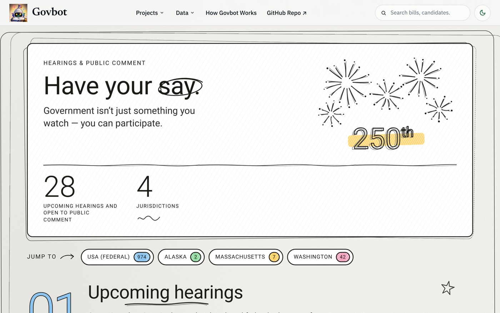
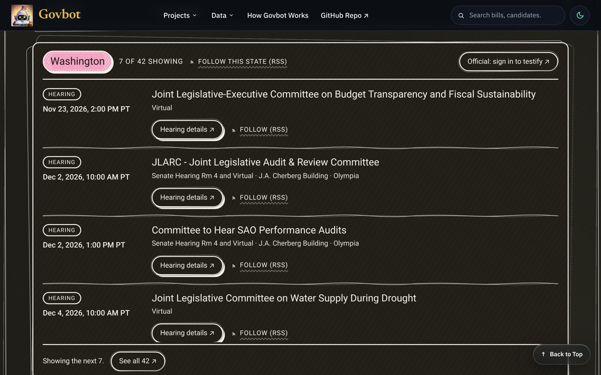
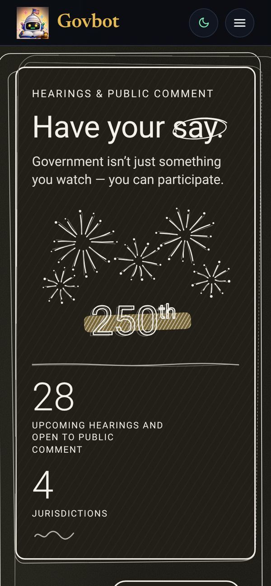
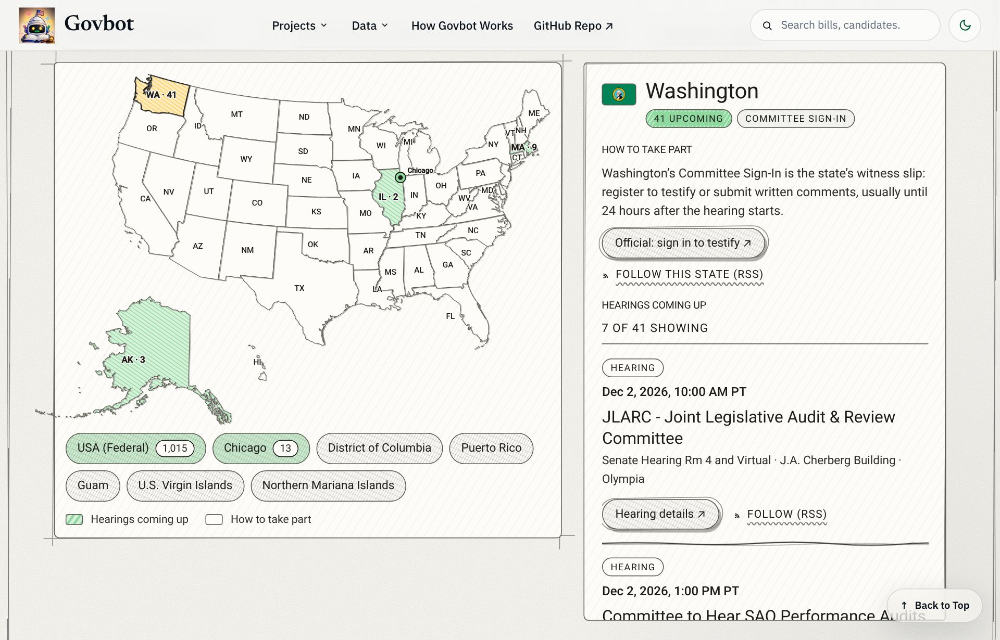
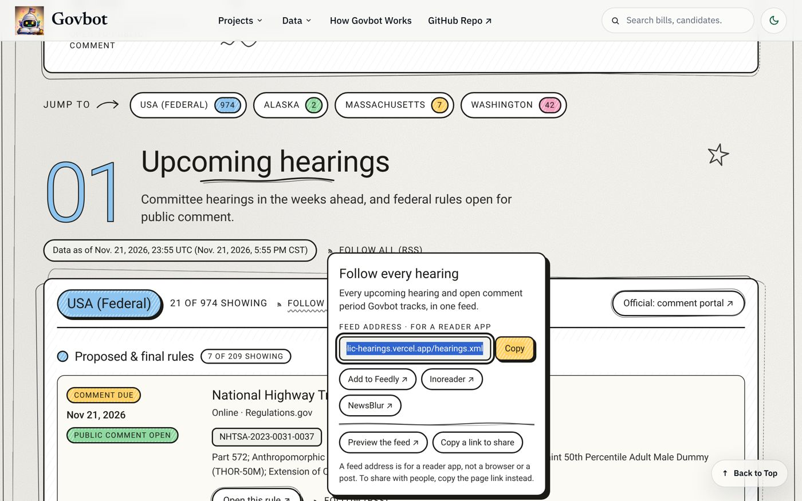
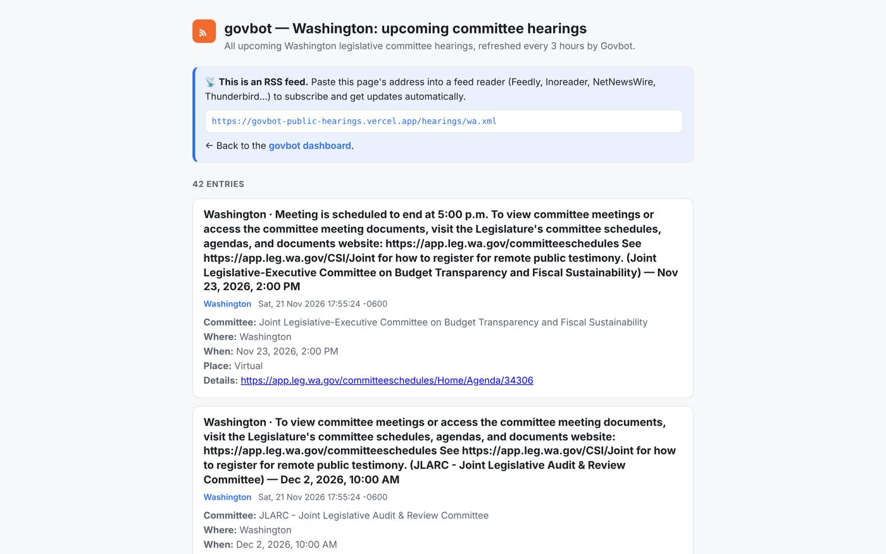
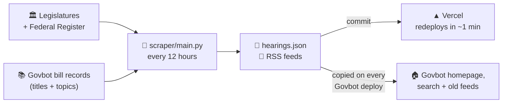

# 🏛️ Govbot Public Hearings

**Govbot Public Hearings lists upcoming state legislative hearings, Chicago City Council meetings and federal rules open for comment, each with the official way to testify or comment.** Every hearing comes from the government's own website, refreshed every 12 hours, and the data is free to download (CC BY 4.0).
Free, open source, nonpartisan. Built on [Govbot](https://chihacknight.github.io/govbot/), Chi Hack Night's open civic data.

[](https://govbot-public-hearings.vercel.app/)
[](.github/workflows/refresh.yml)
[](https://github.com/frankies2727/govbot-public-hearings/actions/workflows/test.yml)
[](https://govbot-public-hearings.vercel.app/hearings.xml)
[](https://github.com/chihacknight/govbot)

### 👉 [govbot-public-hearings.vercel.app](https://govbot-public-hearings.vercel.app/) 👈

<a href="https://govbot-public-hearings.vercel.app/"></a>

## ⚡ The short version

- 📅 **What's coming up.** Committee hearings in the weeks ahead, plus federal rules open for comment.
- ✍️ **How to take part.** Every hearing links the official place to weigh in: a witness slip, a sign-up to testify, or a comment form.
- 🗺️ **Every state covered.** Pick any of the 56 jurisdictions on the map to see how it takes public input, even where we don't list hearings yet.
- 📡 **Follow anything by RSS.** One feed for everything, or one per state, bill or hearing.
- 🧾 **Never made up.** Every hearing comes from the legislature's, city's or Federal Register's own site and links back to it.
- 📦 **Yours to take.** Every meeting kept in git, plus CSV spreadsheets and calendar files to download.

## 🗓️ Where the hearings come from

| | Jurisdiction | Source | How people weigh in |
|---|---|---|---|
| 🇺🇸 | **USA (Federal)** | [Federal Register API](https://www.federalregister.gov/developers/documentation/api/v1) | Comment on Regulations.gov |
| 🌽 | **Illinois** | [ilga.gov](https://ilga.gov) | File a witness slip |
| 🌲 | **Washington** | [leg.wa.gov](https://leg.wa.gov) | Committee sign-in (testify or note a position) |
| 🦞 | **Massachusetts** | [malegislature.gov](https://malegislature.gov) | Submit written testimony |
| 🏔️ | **Alaska** | [akleg.gov](https://akleg.gov) | Public opinion message |
| 🏙️ | **Chicago City Council** (our first city) | [City Clerk eLMS API](https://api.chicityclerkelms.chicago.gov/swagger.json) | Written comment by each meeting's deadline (its Notice says where) |
| 🗺️ | **Every other state, DC, Guam & the U.S. Virgin Islands** | Each legislature's own website, read by [Open States](https://github.com/openstates/openstates-scrapers)' open-source meeting scrapers, which we run ourselves twice a day | The state's own way to take part (on the map) |

Not yet: California, New York, DC, Indiana (their scrapers need a database dump or a free API key), Ohio and the Northern Mariana Islands (their scrapers get past bot protection, which we don't do), Michigan (its site blocks scrapers), Puerto Rico and American Samoa (no scraper yet).

## 📦 Take the data

Every meeting is kept in [`data/`](data/) in git (one JSON file each, history included), and every refresh rebuilds
spreadsheets and calendars at [`/downloads/`](https://govbot-public-hearings.vercel.app/downloads/manifest.json):
`hearings-all.csv`, `hearings-<state>.csv`, and `<state>.ics` to subscribe to in your calendar. CC BY 4.0. See [data/README.md](data/README.md).

## 👀 What people see

<table>
<tr>
<td width="70%"></td>
<td width="30%"></td>
</tr>
<tr>
<td colspan="2"><b>Upcoming hearings</b> for the place you pick, with the official "how to take part" link above them. Works on phones, in light and dark mode.</td>
</tr>
<tr>
<td width="50%"></td>
<td width="50%"></td>
</tr>
<tr>
<td><b>Pick a place.</b> Tap a state, Chicago or the federal agencies on the map.</td>
<td><b>Follow by RSS.</b> Copy the address or add it to a reader in one tap.</td>
</tr>
</table>

## 📡 RSS feeds

| Follow | Feed address |
|---|---|
| Everything | [`/hearings.xml`](https://govbot-public-hearings.vercel.app/hearings.xml) |
| One state | `/hearings/<code>.xml`, for example [`/hearings/wa.xml`](https://govbot-public-hearings.vercel.app/hearings/wa.xml) |
| One bill | `/hearings/<state>-<bill>.xml`, for example `il-HB1643.xml` |
| One hearing | `/hearings/hearing-<id>.xml` |

Open a feed in a browser and it shows as a readable page. Old Govbot addresses (`chihacknight.github.io/govbot/dashboard/hearings.xml` and `/hearings/…`) keep working: Govbot publishes copies.



## ⚙️ How it works



- ⏰ **Twice a day** (07:17 and 19:17 UTC) a GitHub Action runs the scraper and commits what changed. Vercel puts it live.
- 🛟 **Fail-safe.** If a source is down, the site keeps the last good data instead of going blank.
- 🎨 **Same look as Govbot.** The header, menu, footer and styles come straight from Govbot, synced daily.

<details>
<summary><b>📁 What's in this repo</b></summary>

| Folder | What's in it |
| --- | --- |
| `site/` | The published site: `index.html`, `hearings.json`, `participation.json` (how each of 56 jurisdictions takes public input), the RSS feeds and `feed.xsl` (shows a feed as a readable page). Vercel serves it as is, no build step. |
| `scraper/` | `main.py` (standard-library Python only) plus offline tests and real saved responses. See [`scraper/README.md`](scraper/README.md) for each source. |
| `schemas/` | JSON Schemas for `hearings.json` and `participation.json`. |
| `scripts/sync_shell.py` | Copies Govbot's shared header, menu and footer into the page. |
| `docs/readme/` | The screenshots in this README. |

</details>

<details>
<summary><b>🧑‍💻 Run it on your computer</b></summary>

```bash
python3 -m http.server -d site 8000          # open http://localhost:8000
python3 scraper/test_scrape_hearings.py      # offline tests, no network
bash scraper/render-snapshots.sh             # rebuild the expected snapshot after a parser change
python3 scraper/main.py --jurisdictions il,wa,ma,ak,chi,us \
  --output site/hearings.json --rss site/hearings.xml --rss-feeds-dir site/hearings \
  --participation site/participation.json    # a live scrape
```

No installs needed: Python 3 is enough.

</details>

<details>
<summary><b>🤖 Workflows</b></summary>

| Workflow | When | What |
| --- | --- | --- |
| `refresh.yml` | twice a day + by hand | Scrapes and commits new data. Files are only replaced when the run found at least one hearing. |
| `test.yml` | every push and pull request | Scraper tests, snapshot check, every JSON/XML file parses. |
| `sync-shell.yml` | daily + by hand | Pulls Govbot's latest header and footer. |

Vercel deploys only `main`, no preview deployments, to save Vercel storage (the same as Know Your Ballot).

</details>

## 🤝 Contributing

- 🐛 **Something wrong or missing?** [Open an issue](https://github.com/frankies2727/govbot-public-hearings/issues/new) with a link to the official page.
- 🧪 **Changing the scraper?** Run `python3 scraper/test_scrape_hearings.py` first; it needs no network.
- 📖 **Working with an AI assistant?** [`CLAUDE.md`](CLAUDE.md) has the rules and the design notes.

## 📜 License

Code: same as [Govbot](https://github.com/chihacknight/govbot). Hearing data comes from each legislature's and the Federal Register's public sites, and every record links its source.

## ❓ FAQs

**What is a public hearing?**
A meeting where a legislative committee, city council or agency hears from the public before it acts on a bill or rule. Anyone can take part, and what you say goes on the record.

**How do I testify at a state legislative hearing?**
Find the hearing, then use your state's official way to take part before it starts: a witness slip, an online sign-in, written testimony or a comment form. Each place's steps are on its own page, e.g. [Virginia](https://govbot-public-hearings.vercel.app/places/virginia.html), [Illinois](https://govbot-public-hearings.vercel.app/places/illinois.html), [federal rules](https://govbot-public-hearings.vercel.app/places/federal.html).

**Where does the data come from?**
Each government's own website: our own scrapers for Illinois, Washington, Massachusetts, Alaska and Chicago; Open States' open-source meeting scrapers (run by us) for the other states; the Federal Register for federal rules. Nothing is made up; every hearing links to its official page.

**Can I use the data?**
Yes, free under CC BY 4.0: [`data/`](data/) (one JSON file per meeting, history in git), CSV and calendar files at [`/downloads/`](https://govbot-public-hearings.vercel.app/downloads/manifest.json), and RSS feeds. AI assistants: start at [`llms.txt`](https://govbot-public-hearings.vercel.app/llms.txt).

**Who makes it?**
[Govbot](https://github.com/chihacknight/govbot), an open-source civic data project from Chi Hack Night, Chicago's weekly civic tech meetup. Free, nonpartisan, and it takes no position on any bill.
